<p align="center">
  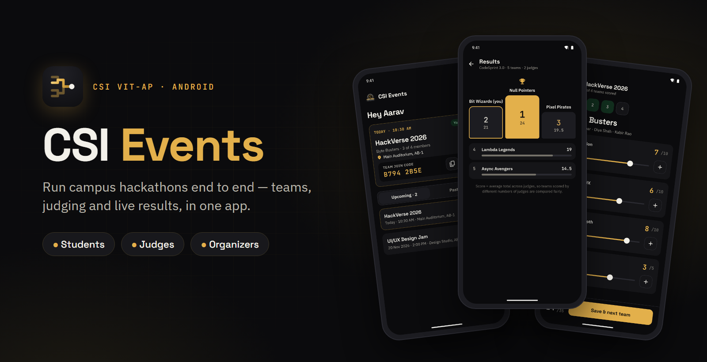
</p>

<p align="center">
  
  
  
  
</p>

<p align="center">
  <b>The official event app of CSI VIT-AP.</b><br>
  Students form teams with a code, judges score from their phones, and results go live the moment the organizer publishes them.
</p>

<p align="center">
  <a href="#-features">Features</a> ·
  <a href="#-screenshots">Screenshots</a> ·
  <a href="#-how-it-works">How it works</a> ·
  <a href="#-architecture">Architecture</a> ·
  <a href="#-getting-started">Getting started</a> ·
  <a href="https://github.com/Harsh181507/csieventmangement">Backend repo</a>
</p>

---

## ✨ Why CSI Events?

Running a hackathon on spreadsheets and paper score sheets is slow and error-prone: teams get lost, judges double-score, and someone spends the evening adding up numbers. **CSI Events replaces all of that with one app** that has a screen for each person in the room:

| 🎓 Students | ⚖️ Judges | 🧭 Organizers |
|---|---|---|
| Create a team or join one with an 8-character code | See only the events and teams you're assigned to | Create and edit events with date, time and venue |
| Share the code on WhatsApp in one tap | Score every criterion with sliders or +/− buttons | Set judging criteria and how many points each is worth |
| See when and where the event is, at a glance | Jump straight to the next team with **Save & next** | Assign judges to all teams or only some |
| Leaders can rename the team and remove members | Never lose unsaved scores — the app asks first | Watch **live standings** while judging is open |
| Results podium the moment they're published | Change a score until the organizer locks scoring | Lock scoring to publish results, export them as a spreadsheet |

---

## 🚀 Features

**Events**
- 📅 Date, start time (clock picker) and venue on every event, shown as *"Today · 10:30 AM · Main Auditorium"*
- 🟢 Events sort themselves: **Upcoming**, **Today** (highlighted), **Ended** and **Results out**
- ✏️ Organizers can edit an event at any time — team size can't drop below the biggest team

**Teams**
- 🔑 Every team gets a join code like `B794 2B5E`, with copy and share buttons
- 👑 The leader can rename the team or remove members (until judging ends)
- 🧮 Team size limits are enforced even when ten people tap *Join* at the same second

**Judging and results**
- 🎚️ Scoring with sliders and +/− buttons, a running total and a progress strip of teams
- ⚖️ Fair ranking: teams are ranked by their **average** across judges, ties share a place
- 🏆 Podium and full ranking for everyone once results are published
- 📄 One-tap **CSV export** with per-criterion scores and member emails, ready for certificates

**Accounts and safety**
- 🎓 Sign-up is limited to `@vitapstudent.ac.in` college emails
- 🔒 5 wrong passwords lock sign-in for 15 minutes; changing your password signs out other devices
- 👤 Edit your name, change your password, or delete your account from Profile (as Google Play requires)
- 🌗 **Dark** ("Midnight Gold") and **light** ("Ledger") themes, or follow the phone

---

## 📱 Screenshots

### 🎓 Student

<table>
  <tr>
    <td align="center">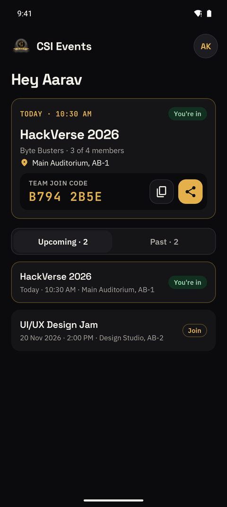<br><sub><b>Home</b><br>Next event and your join code</sub></td>
    <td align="center">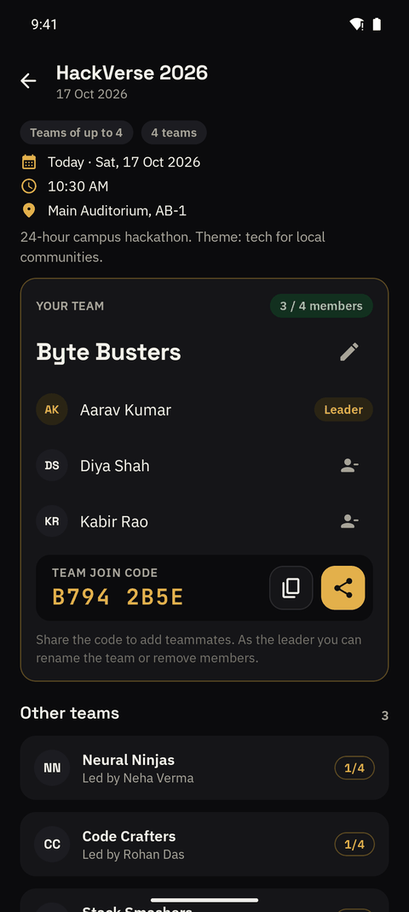<br><sub><b>Your team</b><br>Time, venue and members</sub></td>
    <td align="center">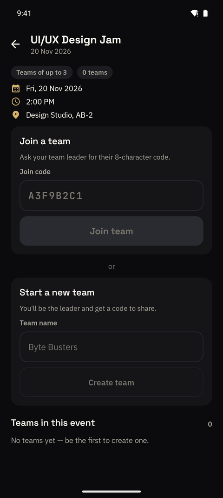<br><sub><b>Join or create</b><br>A code is all you need</sub></td>
    <td align="center">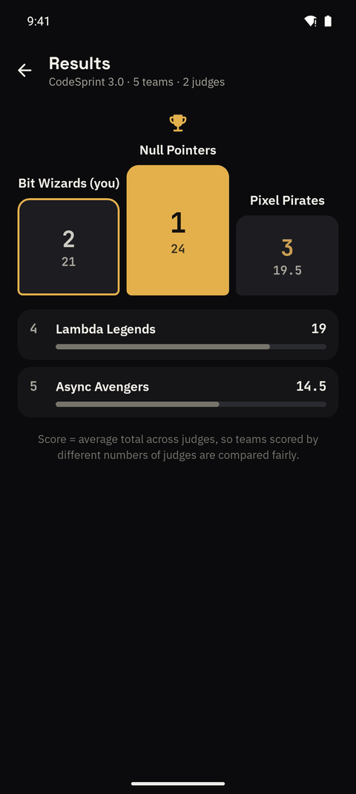<br><sub><b>Results</b><br>Podium, your team highlighted</sub></td>
  </tr>
</table>

### ⚖️ Judge

<table>
  <tr>
    <td align="center">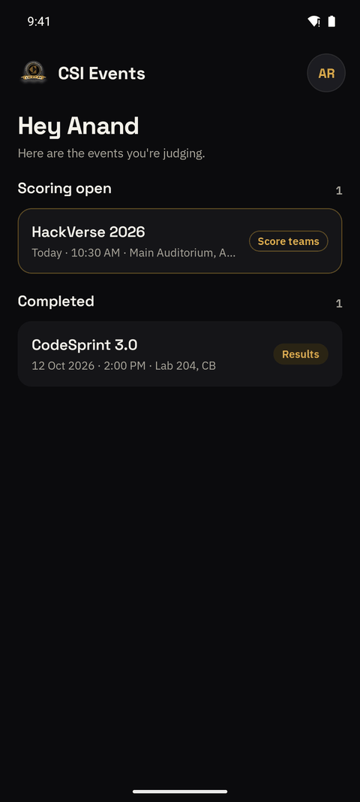<br><sub><b>My events</b><br>Open and completed</sub></td>
    <td align="center">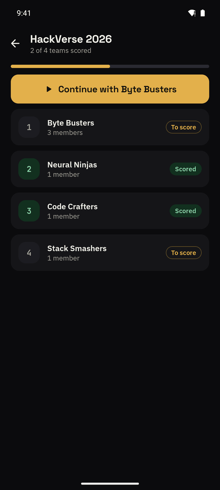<br><sub><b>Teams to score</b><br>Progress at a glance</sub></td>
    <td align="center">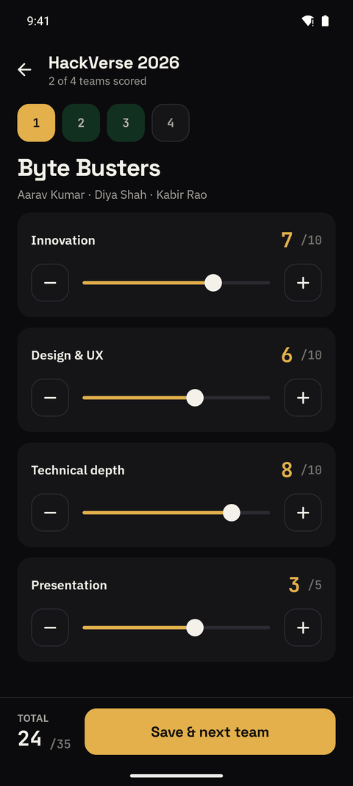<br><sub><b>Scoring</b><br>Sliders, total, save &amp; next</sub></td>
    <td align="center">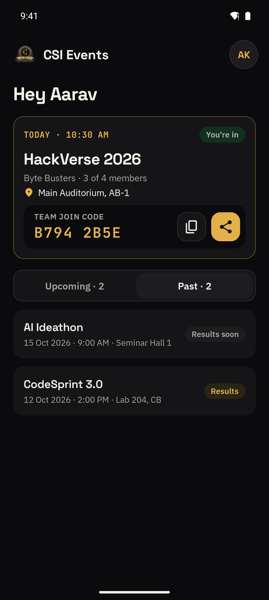<br><sub><b>Past events</b><br>"Results soon" until published</sub></td>
  </tr>
</table>

### 🧭 Organizer

<table>
  <tr>
    <td align="center">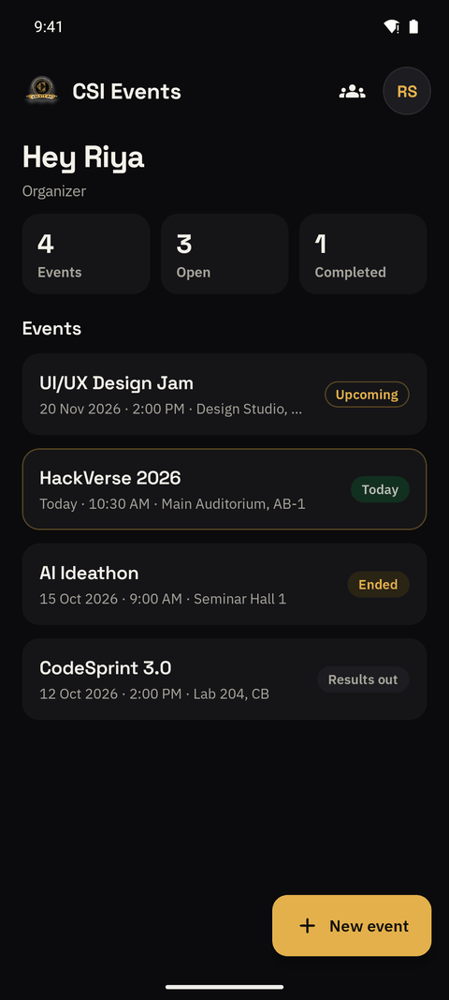<br><sub><b>Dashboard</b><br>Every event and its status</sub></td>
    <td align="center">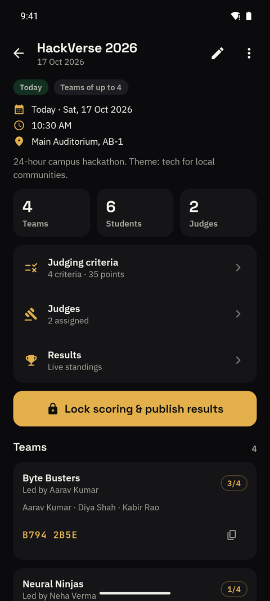<br><sub><b>Event</b><br>Stats, setup and teams</sub></td>
    <td align="center">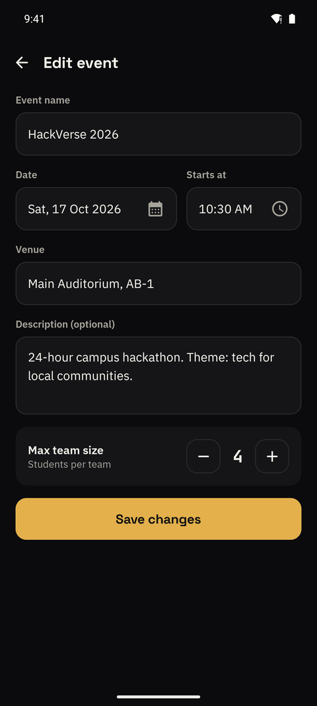<br><sub><b>Create / edit</b><br>Date, time, venue, team size</sub></td>
    <td align="center">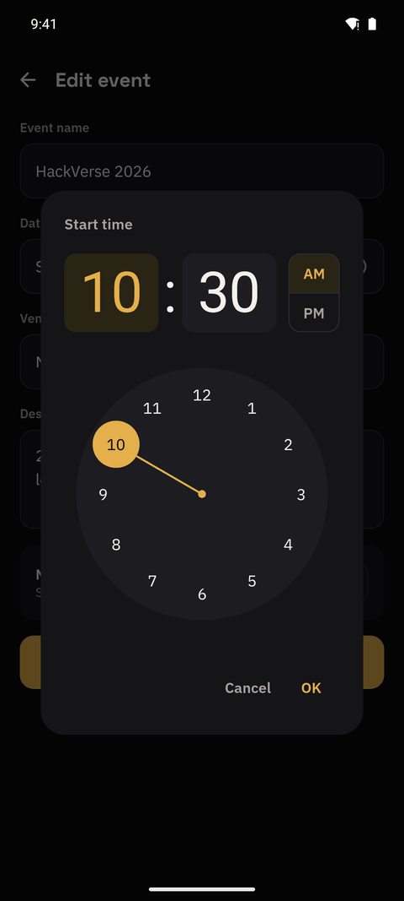<br><sub><b>Start time</b><br>Clock picker</sub></td>
  </tr>
  <tr>
    <td align="center">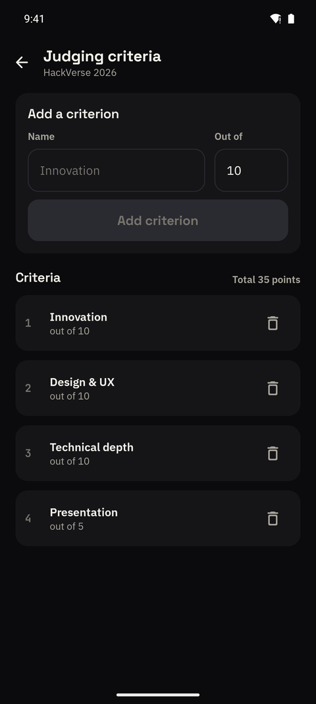<br><sub><b>Criteria</b><br>Points per criterion</sub></td>
    <td align="center">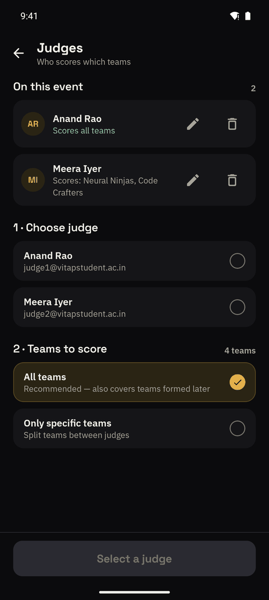<br><sub><b>Judges</b><br>All teams or specific ones</sub></td>
    <td align="center">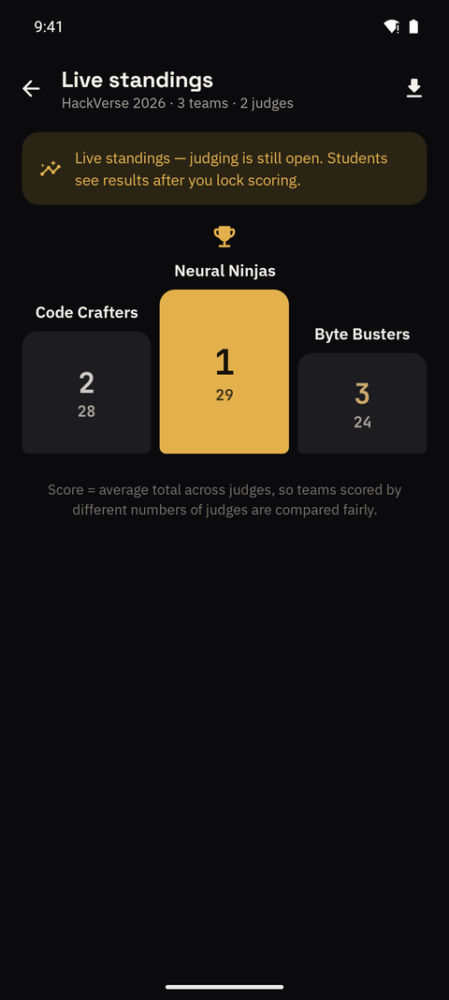<br><sub><b>Live standings</b><br>Plus CSV export</sub></td>
    <td align="center">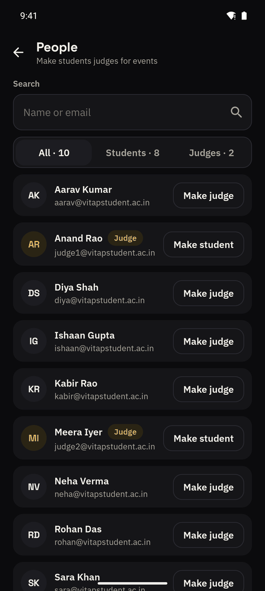<br><sub><b>People</b><br>Promote students to judges</sub></td>
  </tr>
</table>

### 🌗 Light mode

<table>
  <tr>
    <td align="center">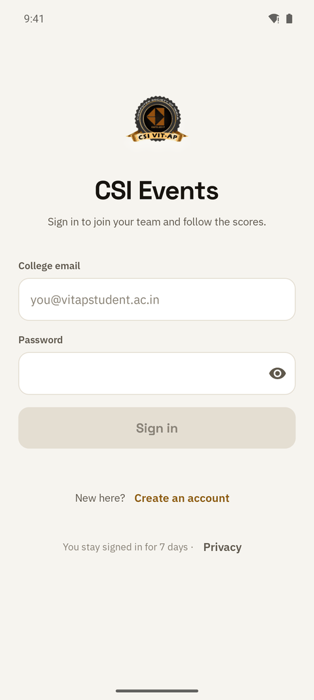<br><sub><b>Sign in</b></sub></td>
    <td align="center">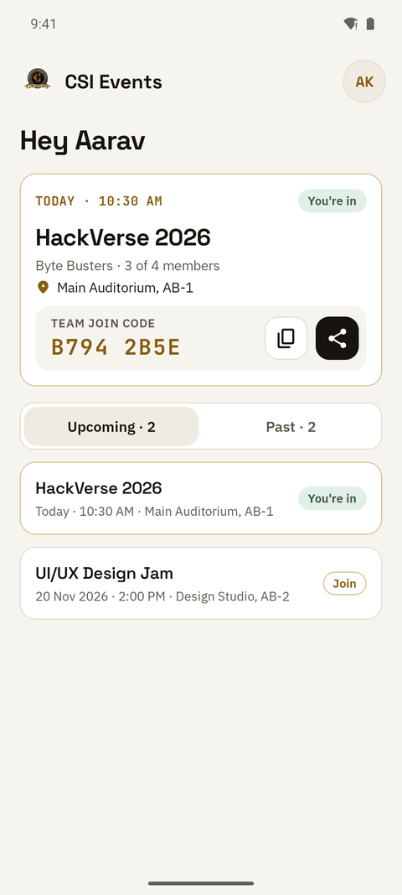<br><sub><b>Home</b></sub></td>
    <td align="center">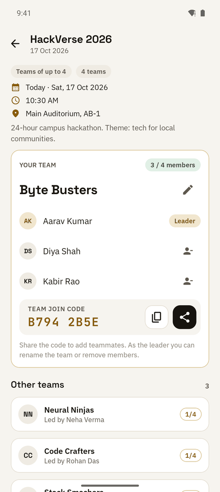<br><sub><b>Your team</b></sub></td>
    <td align="center">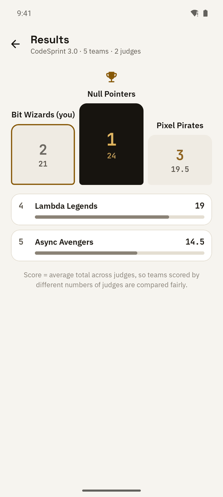<br><sub><b>Results</b></sub></td>
  </tr>
</table>

---

## 🧩 How it works

A whole event, from creation to certificates:

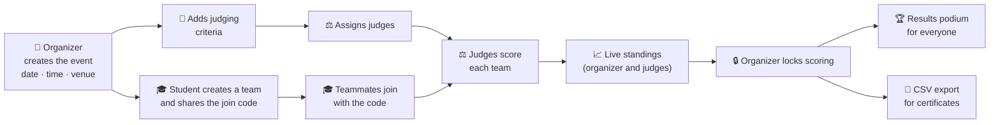

**On event day**

1. **Before the event** — the organizer creates the event, adds criteria such as *Innovation (10)* and *Presentation (5)*, and assigns judges.
2. **Teams form** — one student starts a team and shares the code; teammates enter it to join. The app stops teams going over the size limit, even with everyone joining at once.
3. **Judging** — each judge opens the event, sees exactly the teams they were given, and scores them one after another with *Save & next*.
4. **Live view** — the organizer and judges watch the standings update as scores come in. Students don't see anything yet.
5. **Results** — the organizer taps *Lock scoring & publish results*. Every student sees the podium instantly, and the organizer exports the full results for certificates.

**Roles.** Everyone signs up as a student. Organizers promote students to judges from the **People** screen, and judges get their own home screen the next time they open the app.

---

## 🎨 Design

Two hand-built themes on Material 3, with fonts bundled in the app so it looks the same on every phone.

| | Midnight Gold (dark) | Ledger (light) |
|---|---|---|
| Background | `#0B0B0D` | `#F6F4EF` |
| Surface | `#151518` | `#FFFFFF` |
| Accent | `#E3B04B` gold | `#17140F` ink |
| Highlight | `#E3B04B` | `#8A5D0C` deep gold |

**Type:** Space Grotesk for headings, IBM Plex Sans for text, JetBrains Mono for scores and join codes.
**Icon:** a tournament bracket with one team's path to the win in gold. Source files are in [`store/`](store/).

---

## 🏗 Architecture

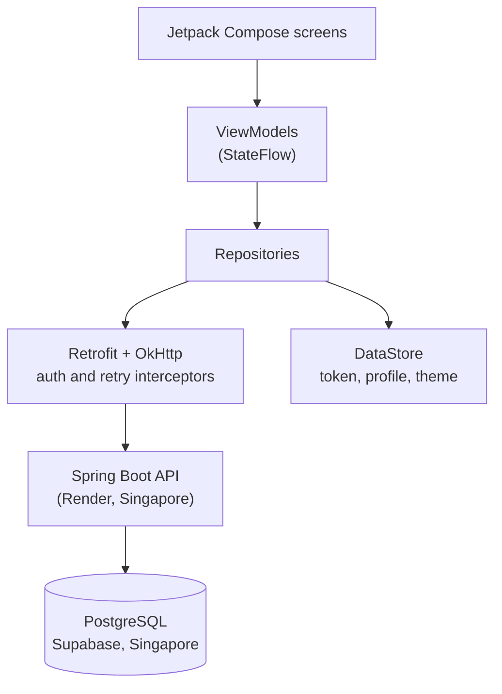

- **MVVM + repositories**, wired with **Hilt**; every screen observes a single `StateFlow` state.
- **Friendly errors**: network failures and server errors become plain messages ("Team is full", "Can't reach the server") instead of codes.
- **Session handling**: the token lives in DataStore; a `401` anywhere sends the user back to sign-in.
- **Built for a slow server start**: generous timeouts and automatic retries, because free hosting can take a minute to wake up.

```
app/src/main/java/com/example/csievent/
├── data/           API interfaces, DTOs, repositories, token and theme storage
├── domain/         repository contracts
├── di/             Hilt modules (network, repositories)
├── presentation/
│   ├── auth/       sign in, register
│   ├── student/    home, event and team
│   ├── judge/      home, teams, scoring
│   ├── organizer/  home, event form, event, criteria, judges, people
│   ├── results/    podium and live standings
│   ├── profile/    theme, name, password, delete account
│   └── components/ design system: buttons, cards, chips, dialogs
└── ui/theme/       colors, type, shapes
```

### Tech stack

| | |
|---|---|
| Language | Kotlin 1.9 |
| UI | Jetpack Compose (BOM 2024.06), Material 3, Navigation Compose |
| DI | Hilt 2.51 |
| Network | Retrofit 2.11, OkHttp 4.12, Gson |
| Async | Kotlin Coroutines + Flow |
| Storage | DataStore Preferences |
| Build | AGP 8.13, minSdk 27 (Android 8.1), targetSdk 36, R8 shrinking (~2 MB APK) |
| Backend | [Spring Boot 3.4 + PostgreSQL](https://github.com/Harsh181507/csieventmangement) |

---

## 🛠 Getting started

**You'll need** a recent Android Studio (2025.1 or newer, for Android Gradle Plugin 8.13) and JDK 17+.

```bash
git clone https://github.com/Harsh181507/CSIeventsApp.git
```

Open the folder in Android Studio, let Gradle sync, and press **Run**. The app talks to the live backend at `https://csieventmangement.onrender.com/` by default.

**Using your own backend.** Run the [backend](https://github.com/Harsh181507/csieventmangement) on your PC, then point a debug build at it:

```bash
./gradlew installDebug -PapiUrl=http://10.0.2.2:8080/
```

`10.0.2.2` is your PC as seen from the emulator; on a real phone use your PC's LAN IP.

**Tests**

```bash
./gradlew testDebugUnitTest
```

---

## 📦 Releasing to Google Play

The app ID is `com.csi.events`, and it can't change once published.

1. **Create an upload key once**, and keep the file and passwords safe; every update needs them:
   ```bash
   keytool -genkeypair -v -keystore csi-events-upload.jks -keyalg RSA -keysize 2048 -validity 10000 -alias csi-events
   ```
2. **Add `keystore.properties`** to the project root (it's gitignored):
   ```properties
   storeFile=csi-events-upload.jks
   storePassword=YOUR_STORE_PASSWORD
   keyAlias=csi-events
   keyPassword=YOUR_KEY_PASSWORD
   ```
3. **Build** with `./gradlew bundleRelease` and upload `app/build/outputs/bundle/release/app-release.aab`. Bump `versionCode` before every release.

**Play Console details**
- Privacy policy: `https://csieventmangement.onrender.com/privacy-policy`
- Account deletion: `https://csieventmangement.onrender.com/delete-account` (in the app: Profile → Delete account)
- Data safety: name and email for account management, not shared, encrypted in transit, deletable
- App access: reviewers need a demo account, because sign-up needs a college email
- Store icon: [`store/icon-512.png`](store/icon-512.png)

---

## 🤝 Contributing

Issues and pull requests are welcome. For a change to the screens, include a screenshot in both themes.

<p align="center">
  <br>
  <sub>Made for <b>CSI VIT-AP</b> · Computer Society of India, VIT-AP Student Chapter</sub>
</p>
